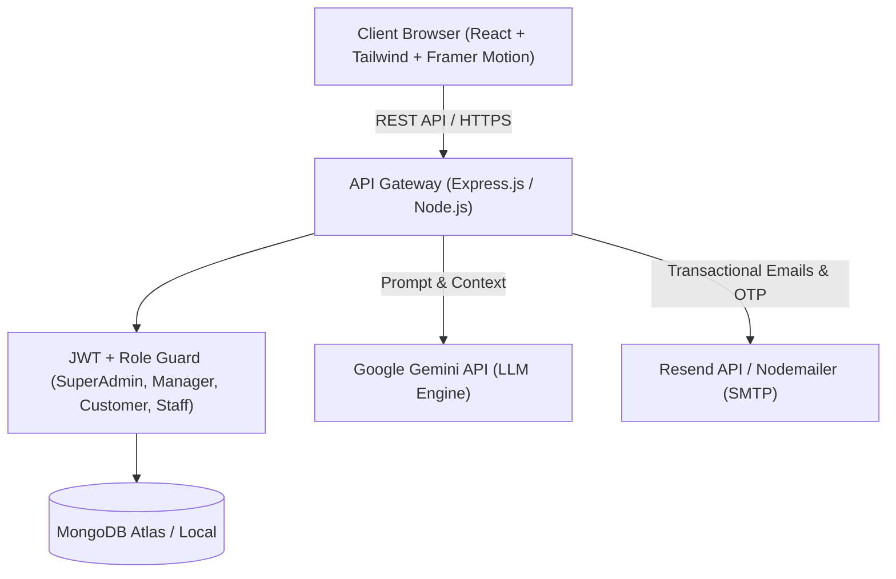
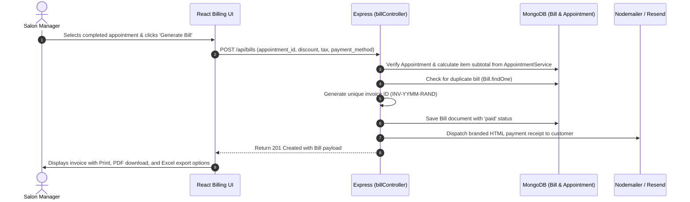
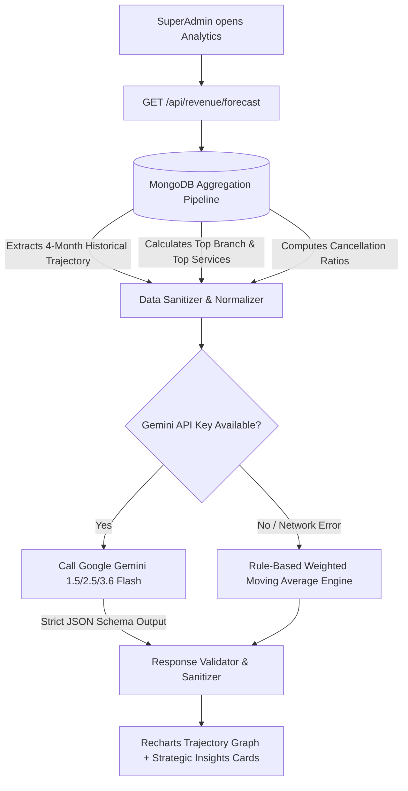
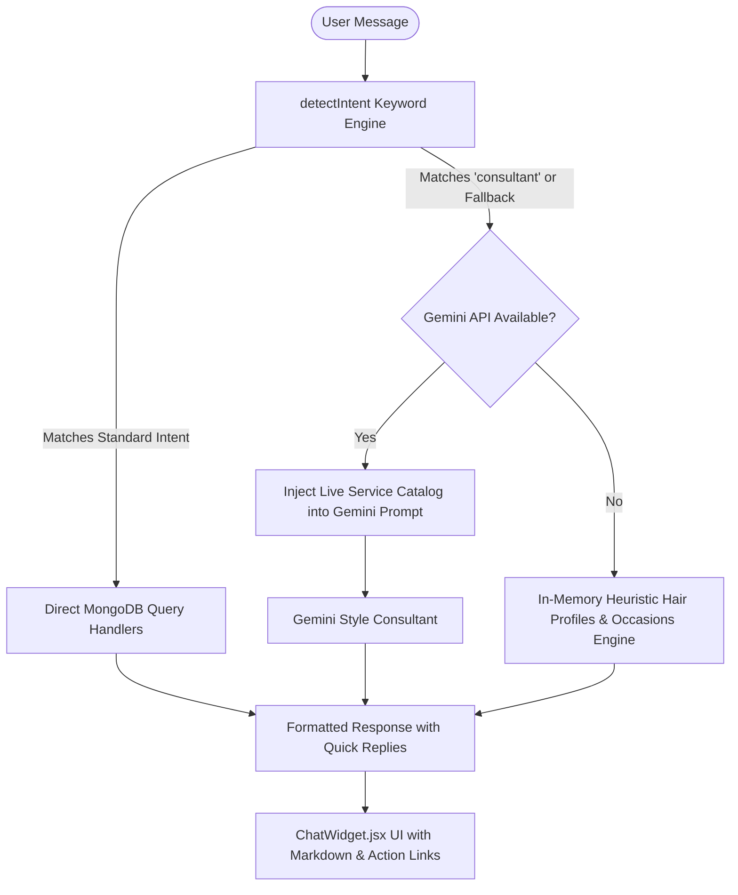
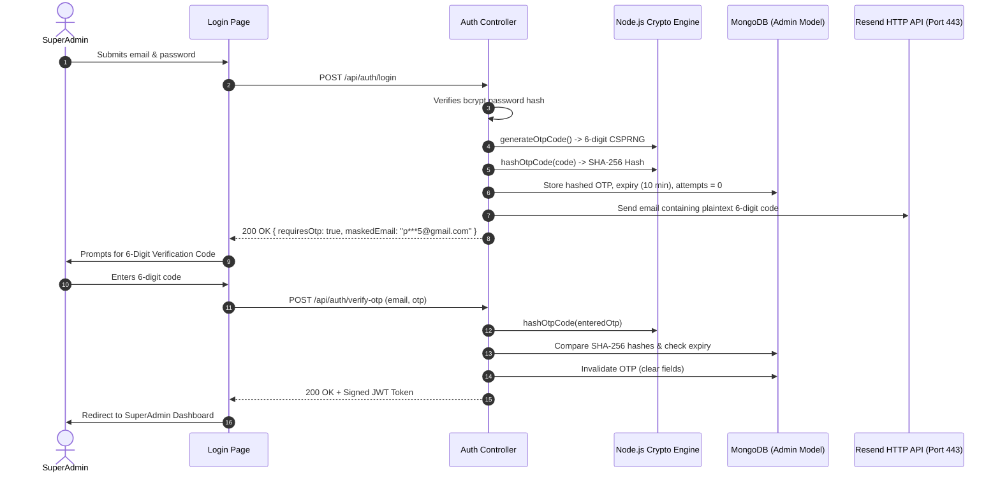
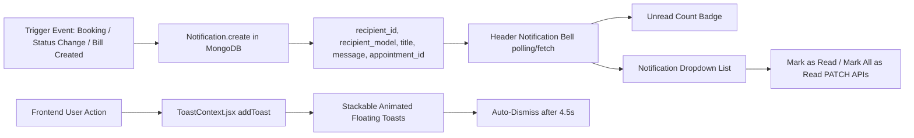

# SalonHub – Comprehensive Viva Presentation Guide

**Project:** SalonHub – Multi-Salon Management Web Platform  
**Target Audience:** Project Examiners, Technical Evaluators, Viva Voce Panel  
**Assigned Categories:**
1. **Reports (Billing & Revenue Reports)**
2. **AI Prediction (Revenue & Appointment Forecasting)**
3. **Chat Bot (Virtual Assistant & AI Style Consultant)**
4. **OTP Feature (Two-Factor Authentication & Password Reset)**
5. **Notifications (Multi-Role Alerts & In-App Toast System)**

---

## Table of Contents
- [1. Executive Architectural Overview](#1-executive-architectural-overview)
- [2. Category 1: Reports (Billing & Financial Reporting)](#2-category-1-reports-billing--financial-reporting)
- [3. Category 2: AI Prediction (Business Intelligence & Forecasting)](#3-category-2-ai-prediction-business-intelligence--forecasting)
- [4. Category 3: Chat Bot (Dual-Engine AI Virtual Assistant)](#4-category-3-chat-bot-dual-engine-ai-virtual-assistant)
- [5. Category 4: OTP Feature (Cryptographic Security & 2FA)](#5-category-4-otp-feature-cryptographic-security--2fa)
- [6. Category 5: Notifications (Event-Driven Alert System)](#6-category-5-notifications-event-driven-alert-system)
- [7. Step-by-Step Viva Live Demonstration Script](#7-step-by-step-viva-live-demonstration-script)
- [8. Master Viva Defense – Frequently Asked Questions (FAQ)](#8-master-viva-defense--frequently-asked-questions-faq)

---

## 1. Executive Architectural Overview

SalonHub is built on the **MERN (MongoDB, Express.js, React, Node.js)** stack with an enterprise-grade multi-tenant architecture designed to manage multiple salon branches, stylists, customer bookings, and financial settlements under strict role-based access control (RBAC).



### Technology Matrix
| Layer | Technologies Used |
| :--- | :--- |
| **Frontend** | React 18, React Router v6, Tailwind CSS, Framer Motion, Lucide Icons, jsPDF, XLSX |
| **Backend** | Node.js, Express.js, Mongoose ODM, JWT, Crypto (Node.js built-in) |
| **AI Integration** | Google Gemini 1.5/2.5/3.6 Flash Models via Google Generative Language REST API |
| **Communications** | Resend HTTP API (Port 443), Nodemailer SMTP |
| **Database** | MongoDB with schema-level validators, indexing, and aggregation pipelines |

---

## 2. Category 1: Reports (Billing & Financial Reporting)

### 2.1 Problem Statement & Business Need
In a multi-salon business, branch managers and super-administrators need accurate, tamper-proof billing records that calculate multi-service breakdowns, handle custom discounts and taxes, prevent duplicate billing, send automated digital receipts, and export comprehensive audit reports in PDF and Excel formats.

### 2.2 Technical Implementation

#### Architecture & Workflow


#### Key Files & Endpoints
- **Controller:** [`backend/controllers/billController.js`](file:///c:/Users/PAWAN%20MADUSHANKA/OneDrive/Desktop/Software%20Project/multi-salon-web-app/backend/controllers/billController.js)
- **Model:** [`backend/models/Bill.js`](file:///c:/Users/PAWAN%20MADUSHANKA/OneDrive/Desktop/Software%20Project/multi-salon-web-app/backend/models/Bill.js)
- **Routes:** [`backend/routes/billRoutes.js`](file:///c:/Users/PAWAN%20MADUSHANKA/OneDrive/Desktop/Software%20Project/multi-salon-web-app/backend/routes/billRoutes.js)
- **Frontend Pages:** [`frontend/src/pages/admin/Billing.jsx`](file:///c:/Users/PAWAN%20MADUSHANKA/OneDrive/Desktop/Software%20Project/multi-salon-web-app/frontend/src/pages/admin/Billing.jsx), [`frontend/src/components/billing/GenerateBillModal.jsx`](file:///c:/Users/PAWAN%20MADUSHANKA/OneDrive/Desktop/Software%20Project/multi-salon-web-app/frontend/src/components/billing/GenerateBillModal.jsx)

#### Endpoints
- `POST /api/bills` – Creates a bill, calculates taxes/discounts, verifies role authorization, and dispatches customer email receipt.
- `GET /api/bills/daily-report?startDate=YYYY-MM-DD&endDate=YYYY-MM-DD` – Aggregates daily, weekly, or custom range metrics: Total Revenue, Completed Appointments, Average Bill, Confirmed Revenue.
- `GET /api/bills/appointment/:appointmentId` – Retrieves existing invoice for a specific appointment.

### 2.3 Key Features to Highlight in Viva
1. **Multi-Service Item Resolution:**
   Supports single-service or multi-service bookings by populating `AppointmentService` models to capture itemized costs and individual stylist assignments:
   ```javascript
   const calculatedSubtotal = items.reduce((sum, it) => sum + (it.price || 0), 0);
   const subtotal = appointment.total_price || calculatedSubtotal || 0;
   const total_amount = Math.max(0, Math.round(subtotal - discountNum + taxNum));
   ```
2. **Dynamic Invoice Numbering:**
   Formats professional invoice numbers with year, month, and random checksum (`INV-${yr}${mo}-${rand}`).
3. **Automated HTML Email Receipts:**
   Sends a styled responsive receipt table directly to the customer's email with service itemization, subtotal, tax, discount, and payment method.
4. **Client-Side Export Engines:**
   - **PDF Generation:** Implemented via `jspdf` and `jspdf-autotable` with custom company headers, table column formatting, and auto-pagination.
   - **Excel Export:** Implemented via `xlsx` (SheetJS) generating binary `.xlsx` workbooks with timestamped filenames (`SalonHub_Billing_Report_YYYY-MM-DD.xlsx`).
   - **Print Engine:** Native browser print layout styling with `@media print` rules.

---

## 3. Category 2: AI Prediction (Business Intelligence & Forecasting)

### 3.1 Problem Statement & Business Need
Salon executives require forward-looking visibility into revenue, customer demand, and salon capacity to plan staff schedules, inventory orders, and promotional campaigns. Rather than relying on static gut feelings, SalonHub uses an **AI-powered Predictive Analytics Engine**.

### 3.2 Technical Implementation



#### Key Files & Endpoints
- **Controller:** [`backend/controllers/revenueController.js`](file:///c:/Users/PAWAN%20MADUSHANKA/OneDrive/Desktop/Software%20Project/multi-salon-web-app/backend/controllers/revenueController.js) (`getAIForecast`, `callGeminiForecast`, `fallbackRuleBasedForecast`)
- **Route:** `GET /api/revenue/forecast` in [`backend/routes/revenueRoutes.js`](file:///c:/Users/PAWAN%20MADUSHANKA/OneDrive/Desktop/Software%20Project/multi-salon-web-app/backend/routes/revenueRoutes.js)
- **Frontend Page:** [`frontend/src/pages/superadmin/Analytics.jsx`](file:///c:/Users/PAWAN%20MADUSHANKA/OneDrive/Desktop/Software%20Project/multi-salon-web-app/frontend/src/pages/superadmin/Analytics.jsx)

### 3.3 Core Algorithm & Dual-Engine Architecture

#### 1. Generative AI Engine (Google Gemini)
Real database metrics are aggregated and piped into an analytical prompt:
- Historical monthly revenue curve
- Current month vs. prior month performance
- Top branch name and revenue share
- Top performing service categories
- Total completed vs. cancelled bookings

**Prompt Engineering Technique:** Uses temperature `0.2` and strict `responseMimeType: "application/json"` to enforce deterministic financial projections:
```json
{
  "targetMonth": "December 2026",
  "projectedRevenueMin": 450000,
  "projectedRevenueMax": 520000,
  "projectedRevenueMid": 485000,
  "projectedGrowthPercent": 14.2,
  "projectedBookings": 135,
  "confidenceScore": 89,
  "topBranchPrediction": "Salon Hub - Colombo 07",
  "executiveSummary": "...",
  "strategicInsights": [
    { "type": "growth", "title": "...", "description": "..." },
    { "type": "capacity", "title": "...", "description": "..." },
    { "type": "marketing", "title": "...", "description": "..." }
  ]
}
```

#### 2. Deterministic Rule-Based Fallback (Mathematical Safety Net)
If the API key is missing or internet connectivity drops, the system seamlessly transitions to a **Weighted Moving Average (WMA)** algorithm:
$$\text{WMA} = \frac{\sum_{i=1}^{n} w_i \times \text{Revenue}_i}{\sum_{i=1}^{n} w_i}$$
Where recent months receive higher weights ($w = [1, 2, 3, 4]$). This prevents the UI from breaking and guarantees 100% platform availability.

### 3.4 Key Visuals on the Frontend
- **Dual-Tone Curve Chart:** Shows actual historical revenue (solid cyan curve) transitioning into predicted revenue (dashed golden curve with shaded confidence min/max bands).
- **Strategic Action Cards:** Categorized into **Growth**, **Capacity Planning**, and **Targeted Marketing**.
- **Confidence Metric Gauge:** Shows mathematical model reliability based on data volume.

---

## 4. Category 3: Chat Bot (Dual-Engine AI Virtual Assistant)

### 4.1 Problem Statement & Business Need
Prospective customers visiting the platform need instant answers regarding salon locations, opening hours, pricing, and appointment bookings 24/7. Additionally, customers often do not know which haircut or treatment suits their face shape or hair condition. The SalonHub ChatBot acts both as a **Customer Support Assistant** and an **AI Style Consultant**.

### 4.2 Architecture & Flow



#### Key Files
- **Backend Controller:** [`backend/controllers/chatbotController.js`](file:///c:/Users/PAWAN%20MADUSHANKA/OneDrive/Desktop/Software%20Project/multi-salon-web-app/backend/controllers/chatbotController.js)
- **Frontend Component:** [`frontend/src/components/chatbot/ChatWidget.jsx`](file:///c:/Users/PAWAN%20MADUSHANKA/OneDrive/Desktop/Software%20Project/multi-salon-web-app/frontend/src/components/chatbot/ChatWidget.jsx)
- **Frontend Service:** [`frontend/src/services/chatService.js`](file:///c:/Users/PAWAN%20MADUSHANKA/OneDrive/Desktop/Software%20Project/multi-salon-web-app/frontend/src/services/chatService.js)

### 4.3 Technical Capabilities
1. **Rule-Based Intent Recognition:**
   Recognizes 11 standard customer queries with sub-millisecond response times:
   - `greeting`, `services`, `pricing`, `booking`, `hours`, `location`, `branches`, `cancel`, `contact`, `consultant`, `thanks`.
2. **Live Database Context Injection:**
   When asked about services or hours, the chatbot queries MongoDB in real-time (`Service.find()`, `Salon.find()`). If a salon admin modifies a service price in the backend, the chatbot immediately reflects the new price!
3. **AI Style Consultant:**
   Users can type: *"I have frizzy wavy hair and a wedding next month, what do you recommend?"*
   - Gemini evaluates hair characteristics (curly, wavy, straight, damaged, thin).
   - Gemini cross-references with actual SalonHub services (e.g., Keratin Deep Treatment, Balayage).
   - Generates tailored styling advice and embeds a direct markdown link: `👉 [Book This Service Now](/book)`.
4. **Interactive UI Features in [`ChatWidget.jsx`](file:///c:/Users/PAWAN%20MADUSHANKA/OneDrive/Desktop/Software%20Project/multi-salon-web-app/frontend/src/components/chatbot/ChatWidget.jsx):**
   - Floating circular toggle button with animated pulse indicator.
   - Quick-reply chip buttons for frictionless single-click navigation.
   - Markdown rendering for bold text, lists, and clickable hyperlinks.
   - Session chat history stored in local state.

---

## 5. Category 4: OTP Feature (Cryptographic Security & 2FA)

### 5.1 Problem Statement & Business Need
Administrative accounts (SuperAdmin, Salon Managers) hold privileged access to payroll, client records, and revenue analytics. Standard password-only authentication is vulnerable to credential stuffing and phishing. SalonHub enforces a **Two-Factor Authentication (2FA) OTP system** for administrative login and secure self-service password reset.

### 5.2 Technical Security Architecture



#### Key Files
- **Utility:** [`backend/utils/emailOtp.js`](file:///c:/Users/PAWAN%20MADUSHANKA/OneDrive/Desktop/Software%20Project/multi-salon-web-app/backend/utils/emailOtp.js)
- **Controller:** [`backend/controllers/authController.js`](file:///c:/Users/PAWAN%20MADUSHANKA/OneDrive/Desktop/Software%20Project/multi-salon-web-app/backend/controllers/authController.js)
- **Frontend Pages:** [`frontend/src/pages/auth/Login.jsx`](file:///c:/Users/PAWAN%20MADUSHANKA/OneDrive/Desktop/Software%20Project/multi-salon-web-app/frontend/src/pages/auth/Login.jsx), [`frontend/src/pages/auth/ForgotPassword.jsx`](file:///c:/Users/PAWAN%20MADUSHANKA/OneDrive/Desktop/Software%20Project/multi-salon-web-app/frontend/src/pages/auth/ForgotPassword.jsx)

### 5.3 Technical Security Highlights
1. **Cryptographically Secure PRNG:**
   Instead of `Math.random()` (which is predictable and pseudorandom), uses Node.js `crypto.randomInt(100000, 1000000)`.
2. **Zero-Knowledge Storage (SHA-256):**
   The plain OTP is **never saved to the database**. It is immediately hashed:
   ```javascript
   export const hashOtpCode = (code) => {
     return crypto.createHash("sha256").update(String(code).trim()).digest("hex");
   };
   ```
   Even if a database dump is compromised, attackers cannot read the OTP codes.
3. **Brute-Force Rate Limiting:**
   Each verification attempt increments an `attempts` counter. If the user fails 5 times (`MAX_OTP_ATTEMPTS = 5`), the OTP is invalidated immediately.
4. **Anti-Spam Resend Cooldown:**
   Enforces a 60-second cooldown timer between resend requests (`OTP_RESEND_COOLDOWN_MS = 60000`).
5. **Port-443 Cloud Resilience (Resend API):**
   Standard SMTP ports (25, 465, 587) are frequently blocked by cloud hosting providers (Render, AWS, DigitalOcean). SalonHub implements a dual-mode dispatch:
   - Primary: Resend HTTP REST API over standard HTTPS Port 443 (guaranteed delivery).
   - Secondary Fallback: Nodemailer SMTP over Gmail.
6. **Data Privacy Masking:**
   The client UI never displays the full raw email address, returning `p***5@gmail.com` via `maskEmail()`.

---

## 6. Category 5: Notifications (Event-Driven Alert System)

### 6.1 Problem Statement & Business Need
Salon operations involve rapid state changes: bookings are requested, confirmed, rescheduled, cancelled, or paid. Without an automated notification mechanism, customers miss appointments and managers fail to respond to new requests.

### 6.2 Technical Architecture

SalonHub implements a **Dual-Layer Notification Framework**:
1. **Persistent Database Notifications:** Stored in MongoDB for audit history and accessible via the header notification bell.
2. **Ephemeral In-App Toast Alerts:** React Context-driven animated notifications providing immediate user feedback on actions.



#### Key Files
- **Model:** [`backend/models/Notification.js`](file:///c:/Users/PAWAN%20MADUSHANKA/OneDrive/Desktop/Software%20Project/multi-salon-web-app/backend/models/Notification.js)
- **Controller:** [`backend/controllers/notificationController.js`](file:///c:/Users/PAWAN%20MADUSHANKA/OneDrive/Desktop/Software%20Project/multi-salon-web-app/backend/controllers/notificationController.js)
- **Routes:** [`backend/routes/notificationRoutes.js`](file:///c:/Users/PAWAN%20MADUSHANKA/OneDrive/Desktop/Software%20Project/multi-salon-web-app/backend/routes/notificationRoutes.js)
- **Frontend Components:**
  - Database Alerts: [`CustomerHeader.jsx`](file:///c:/Users/PAWAN%20MADUSHANKA/OneDrive/Desktop/Software%20Project/multi-salon-web-app/frontend/src/components/layout/CustomerHeader.jsx), [`Header.jsx`](file:///c:/Users/PAWAN%20MADUSHANKA/OneDrive/Desktop/Software%20Project/multi-salon-web-app/frontend/src/components/layout/Header.jsx), [`adminHeader.jsx`](file:///c:/Users/PAWAN%20MADUSHANKA/OneDrive/Desktop/Software%20Project/multi-salon-web-app/frontend/src/components/layout/adminHeader.jsx)
  - In-App Toast: [`ToastContext.jsx`](file:///c:/Users/PAWAN%20MADUSHANKA/OneDrive/Desktop/Software%20Project/multi-salon-web-app/frontend/src/context/ToastContext.jsx)

### 6.3 Technical Implementation Details

#### Polymorphic Notification Model
```javascript
const notificationSchema = new mongoose.Schema({
  recipient_id: { type: mongoose.Schema.Types.ObjectId, required: true },
  recipient_model: { type: String, required: true, enum: ["Customer", "Admin", "Staff"] },
  title: { type: String, required: true },
  message: { type: String, required: true },
  is_read: { type: Boolean, default: false },
  appointment_id: { type: mongoose.Schema.Types.ObjectId, ref: "Appointment", default: null }
}, { timestamps: true });
```
This polymorphic structure allows a single unified collection to deliver targeted alerts to customers, branch managers, or stylists.

#### Event Triggers in the Backend
- **Booking Placed:** Creates notification for salon manager.
- **Booking Confirmed/Cancelled:** Creates notification for customer.
- **Bill Issued:** Creates notification linking to the invoice.
- **Salon Status Updates:** Broadcasts operational changes.

#### Interactive Toast Context Engine
Implemented in [`ToastContext.jsx`](file:///c:/Users/PAWAN%20MADUSHANKA/OneDrive/Desktop/Software%20Project/multi-salon-web-app/frontend/src/context/ToastContext.jsx):
- Supports 4 alert types: `success`, `error`, `warning`, `info`.
- Fixed position z-index stack (`z-[99999]`) ensuring visibility over modals.
- Smooth exit animations using Framer Motion `<AnimatePresence>`.
- Auto-cleanup timer with explicit user close button.

---

## 7. Step-by-Step Viva Live Demonstration Script

Follow this chronological presentation flow during your live demonstration:

### Part 1: OTP Feature (Login & Security) — 2 Minutes
1. Navigate to the **Login Page** (`/login`).
2. Enter the SuperAdmin credentials:
   - Email: `superadmin@gmail.com`
   - Password: `Password123`
3. Click **Sign In**.
4. **Point to Screen:** Show that the system intercepts the login and transitions to the **2FA Verification Screen**, displaying the masked email `s***n@gmail.com`.
5. Open your terminal or email inbox and display the generated 6-digit OTP.
6. **Explain to Examiner:** *"We generate this OTP using Node's cryptographic CSPRNG and store only its SHA-256 hash in MongoDB with a 10-minute expiry."*
7. Enter the 6-digit code and verify &rarr; Redirects to the Dashboard.

### Part 2: AI Prediction & Analytics — 2 Minutes
1. From the SuperAdmin sidebar, navigate to **Analytics** (`/superadmin/analytics`).
2. Scroll to the **AI Revenue & Demand Forecast** section.
3. **Point to the Graph:**
   - Show the solid line (actual historical revenue) and the dashed golden line (Gemini-predicted revenue for next month).
   - Point out the **Min, Mid, and Max** projected bounds.
4. **Point to the Insights Cards:**
   - Read the **Executive Summary**.
   - Show the 3 AI-generated strategic insights: *Growth/Bundling*, *Capacity/Staffing*, and *Client Retention*.
5. **Explain to Examiner:** *"This prompt dynamically consumes real historical figures from our MongoDB database and passes them to Gemini Flash with strict JSON schema constraints. If offline, our Weighted Moving Average fallback algorithm seamlessly activates."*

### Part 3: Billing & Reports — 2 Minutes
1. Navigate to **Billing & Reports** (`/admin/billing` or SuperAdmin view).
2. Show the **KPI Summary Cards**: Total Revenue, Completed Bills, Average Bill Amount, Projected Revenue.
3. Filter by date presets: Click **This Month**, **This Week**, or select a custom date range.
4. Click **Download PDF**:
   - Open the downloaded PDF file.
   - Show the branded header, formatted table columns, and tax/discount calculations generated by `jspdf-autotable`.
5. Click **Export Excel**:
   - Show the `.xlsx` file generated via SheetJS.
6. Open an appointment and click **Generate Bill**:
   - Demonstrate adding a 10% discount and tax.
   - Click generate &rarr; Show that an automated HTML receipt is triggered to the customer's email.

### Part 4: Chat Bot & AI Style Consultant — 2 Minutes
1. Click the floating **ChatBot icon** in the bottom-right corner.
2. Click the quick-reply chip **"Our Services"**:
   - Notice how it queries the live database and lists current salon services with real prices in LKR.
3. Type a freeform styling question:
   - *"I have curly frizzy hair and I need advice for a formal party."*
4. Press Send:
   - Watch the AI Style Consultant reply with recommended cuts, a 3-step washing routine, matching SalonHub services with prices, and a clickable `👉 [Book This Service Now](/book)` button.
5. Click the link to show seamless navigation to the appointment booking flow.

### Part 5: Notifications & In-App Alerts — 1 Minute
1. Look at the top navigation header:
   - Point to the **Notification Bell** showing the unread count badge.
2. Click the bell to open the dropdown:
   - Show recent notifications for bookings and bill payments.
   - Click **Mark as Read** or **Mark All as Read** and watch the unread badge update in real-time.
3. Trigger an action (e.g., cancel a booking or generate a bill) and observe the animated **Framer Motion Toast Alert** appear in the top-right corner.

---

## 8. Master Viva Defense – Frequently Asked Questions (FAQ)

### Questions on Billing & Reports
> **Q1: How do you prevent duplicate bills for the same appointment?**  
> **A:** Before creating a bill, we query `Bill.findOne({ appointment_id: appointment._id })`. If an invoice record already exists, the backend returns the existing bill with an informative status message instead of creating a redundant entry.

> **Q2: Why do you calculate the subtotal on the server rather than trusting the client?**  
> **A:** Client-side values can be manipulated via browser developer tools. Our server independently fetches the appointment and its linked `AppointmentService` records, recalculates the true subtotal, validates that discounts do not exceed the total, and clamps negative values using `Math.max(0, subtotal - discount + tax)`.

> **Q3: How is the PDF generated? Is it rendered on the backend or frontend?**  
> **A:** It is generated on the client side using `jspdf` and `jspdf-autotable`. This eliminates server CPU rendering overhead and bandwidth usage, resulting in instant client-side downloads without server file storage bloat.

---

### Questions on AI Prediction
> **Q4: Why did you choose Google Gemini over OpenAI GPT-4?**  
> **A:** Google Gemini Flash (`gemini-3.6-flash` / `gemini-flash-latest`) provides fast inference times (~600ms), native JSON schema enforcement, a generous free-tier quota ideal for university and commercial deployments, and high analytical reasoning on numerical tabular datasets.

> **Q5: What happens if the internet goes down or the Gemini API quota expires during a demo?**  
> **A:** We designed a fault-tolerant dual engine. The backend wraps the Gemini call in a try-catch block and checks HTTP response statuses. If Gemini fails, `callGeminiForecast` returns `null`, and the system automatically falls back to `fallbackRuleBasedForecast`, which calculates a 4-month Weighted Moving Average (WMA) with a linear trend multiplier. The user experience remains uninterrupted.

> **Q6: How do you ensure the AI does not hallucinate fake numbers?**  
> **A:** We use **Retrieval-Augmented Prompt Engineering (RAG)**: We compute real historical sums, cancellation rates, and top salon metrics directly from MongoDB via aggregation pipelines and feed those concrete figures into the prompt. Furthermore, we set the model temperature to a low `0.2`, which minimizes creativity and maximizes adherence to the facts.

---

### Questions on Chat Bot
> **Q7: What is the benefit of your hybrid rule-based + generative AI chatbot architecture?**  
> **A:** Standard transactional questions like *"What are your opening hours?"* or *"Where is your branch?"* do not need expensive LLM calls. Our regex keyword intent detector resolves them in < 5ms by querying MongoDB directly. We reserve the Gemini LLM for creative, consultative queries like hair recommendations, maximizing both speed and cost-efficiency.

> **Q8: How does the chatbot stay updated when a salon adds a new service?**  
> **A:** The chatbot does not have hardcoded service lists. When answering service inquiries or injecting context into Gemini, it queries `Service.find().populate('salon_id')` in real-time. Any service added in the admin dashboard is immediately visible to the chatbot.

---

### Questions on OTP Feature
> **Q9: Why don't you store the 6-digit OTP code directly in the database?**  
> **A:** Storing plaintext credentials or authentication tokens is a major security vulnerability. If an unauthorized party gains access to a database backup, plaintext OTPs would allow account takeovers. We store a **SHA-256 cryptographic hash** of the OTP. When the user enters their code, we hash the input and compare the hashes.

> **Q10: Why did you use Resend API instead of standard Nodemailer SMTP?**  
> **A:** Cloud platforms such as Render, AWS EC2, and Heroku block outbound SMTP traffic on ports 25, 465, and 587 to prevent spam. Resend communicates over HTTPS port 443 via a REST API, ensuring that OTP emails are never blocked by cloud firewalls.

> **Q11: How do you protect against brute-force attacks on the 6-digit code?**  
> **A:** We enforce three layers of defense:
> 1. **Expiration:** Codes expire after 10 minutes.
> 2. **Attempt Limiting:** A maximum of 5 failed attempts is allowed (`MAX_OTP_ATTEMPTS = 5`), after which the code is invalidated.
> 3. **Rate Limiting:** A 60-second cooldown is enforced before a new code can be requested.

---

### Questions on Notifications
> **Q12: Explain the polymorphic structure of your Notification model.**  
> **A:** We use Mongoose's polymorphic reference capability: `recipient_id` stores an `ObjectId`, and `recipient_model` specifies either `"Customer"`, `"Admin"`, or `"Staff"`. This allows a single collection to handle alerts across all platform user roles with clean query indexing on `{ recipient_id: 1, is_read: 1 }`.

> **Q13: What is the difference between your database notifications and Toast notifications?**  
> **A:** Database notifications are persistent and auditable, tied to critical lifecycle events like appointment status updates and invoice issuance. Toast notifications (via `ToastContext.jsx`) are transient UI feedback mechanisms that alert the user of instantaneous client-side operations (e.g., successful form submission or validation errors) and auto-dismiss after 4.5 seconds.

---

## 9. Quick Presentation Checklist
- [ ] Backend running (`npm run dev` in `backend/` on port 5000)
- [ ] Frontend running (`npm start` in `frontend/` on port 3000)
- [ ] MongoDB connected (local instance or MongoDB Atlas)
- [ ] `.env` file checked for `GEMINI_API_KEY`, `RESEND_API_KEY`, and `EMAIL_USER`
- [ ] Open SuperAdmin login tab, Customer booking tab, and Email inbox / Terminal
- [ ] Rehearse the 9-minute demonstration flow outlined in Section 7
